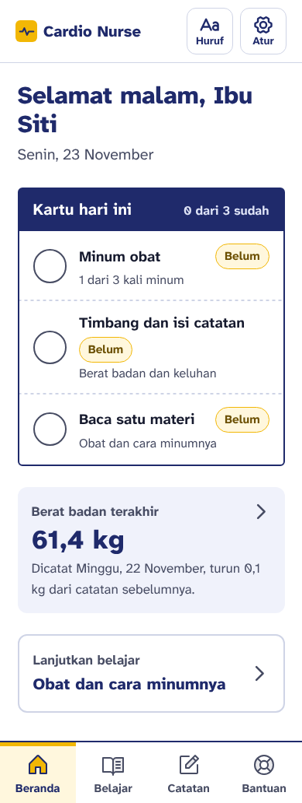
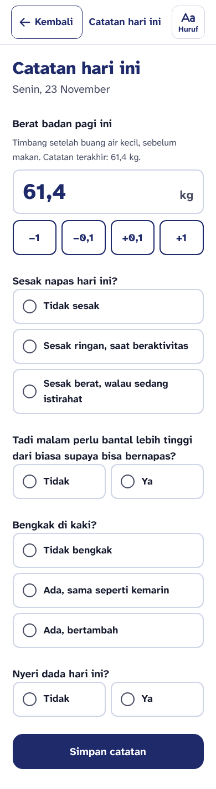
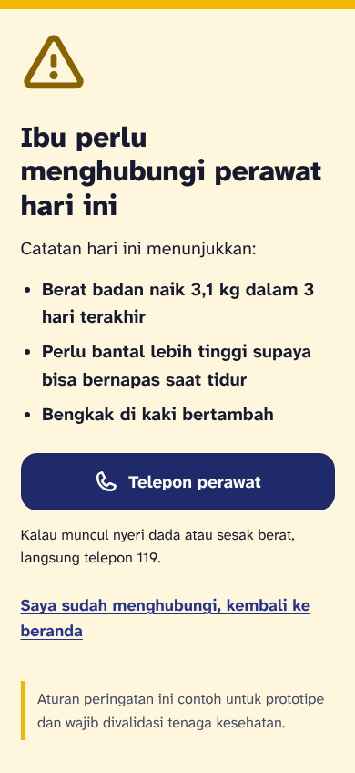
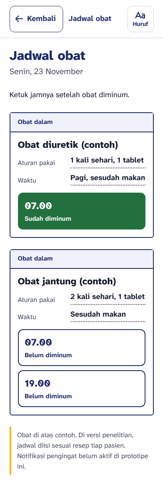

# Cardio Nurse — prototipe

Prototipe web media edukasi digital untuk pasien gagal jantung, untuk mendukung perawatan mandiri. Dibuat untuk penelitian *Pengembangan dan Uji Kegunaan Media Edukasi Digital Cardio Nurse Berbasis Kebutuhan Pasien Gagal Jantung untuk Mendukung Perawatan Mandiri*.

> Semua materi, aturan tanda bahaya, nomor kontak, jadwal obat, dan teks persetujuan di prototipe ini adalah **contoh**. Isi final disusun peneliti dan wajib divalidasi ahli materi sebelum dipakai ke pasien.

<p>
  
  
  
  
</p>

## Coba jalankan

Butuh Node.js 22.

```bash
npm install
npm run dev      # buka alamat yang muncul di terminal
npm run build    # hasil siap online ada di folder dist/
```

Masuk untuk uji coba: kode **CN-001**, PIN **123456**.
Di menu **Atur** ada tombol "Isi data contoh 7 hari" supaya grafik berat badan langsung terisi.

## Isi prototipe

| Bagian | Isi |
| --- | --- |
| Persetujuan | Lembar persetujuan penelitian (teks dari peneliti), bisa menolak |
| Masuk | Kode responden + PIN 6 angka dengan tombol angka besar, akun dibuatkan peneliti |
| Perkenalan | 3 layar singkat, tanpa geser |
| Kenalan | Sapaan Bapak/Ibu, nama panggilan, usia, dibantu keluarga atau tidak |
| Beranda | Kartu hari ini (obat, catatan, materi), berat badan terakhir, lanjutkan belajar |
| Belajar | 6 modul + kuis 3 soal per modul, tombol "Dengarkan materi" (suara bawaan HP) |
| Catatan | Berat badan (tombol ±0,1 / ±1 kg) dan 4 pertanyaan gejala, grafik 14 hari, riwayat |
| Tanda bahaya | Layar peringatan dengan tombol telepon perawat / 119 |
| Jadwal obat | Kartu bergaya etiket apotek, ketuk jam untuk tandai sudah diminum |
| Bantuan | Telepon perawat, 119, dan tanya-jawab |
| Atur | Ukuran huruf (Normal / Besar / Sangat besar), keluar, hapus data |

Data tersimpan di HP masing-masing (localStorage), belum ada server.

## Keputusan desain

- **Font: [Atkinson Hyperlegible Next](https://www.brailleinstitute.org/freefont/)** dari Braille Institute, dirancang untuk pembaca dengan penglihatan rendah. Huruf yang mirip (O dan 0, l dan I) dibuat berbeda, cocok untuk lansia dan untuk membaca kode responden.
- **Ikon: [Phosphor](https://phosphoricons.com)** versi duotone. Lapisan kedua ikon diwarnai kuning kunyit.
- **Warna:** indigo (batik) sebagai warna utama, kuning kunyit sebagai aksen. Merah hanya dipakai untuk tanda bahaya, supaya maknanya tidak luntur.
- **Motif dari dunia pasien:** jadwal obat meniru etiket apotek, dan "Kartu hari ini" meniru kartu kontrol cetak dengan garis isian titik-titik.
- **Lansia friendly:** huruf dasar 18 px dengan tombol Huruf di setiap layar, area sentuh minimal 56 px, satu tujuan per layar, tombol Kembali selalu tertulis, tanpa gerakan geser yang tersembunyi. Mengacu pada [Gomez-Hernandez dkk., 2023 (JMIR mHealth)](https://mhealth.jmir.org/2023/1/e43186/).

## Yang perlu diisi peneliti

Lihat lembar "Kebutuhan app". Yang paling berpengaruh ke kode:

- `src/content.js`: naskah 6 modul, soal kuis, FAQ, nomor kontak, contoh jadwal obat, angka ambang tanda bahaya
- `src/store.jsx` → `evaluateLog`: aturan kapan peringatan muncul (wajib divalidasi klinisi)
- `src/screens/Onboarding.jsx` → `Consent`: teks persetujuan dari kaji etik
- Login sungguhan dan penyimpanan di server (kalau panel nakes jadi dibuat)

## Online lewat GitHub Pages

Workflow ada di `.github/workflows/deploy.yml`. Aktifkan sekali di **Settings → Pages → Source: GitHub Actions**. Setelah itu setiap push ke `main` otomatis online. (GitHub Pages untuk repo private butuh akun GitHub berbayar; untuk repo public gratis.)

## Struktur

```
src/
  content.js        isi materi, kuis, kontak, aturan (contoh)
  store.jsx         penyimpanan data + aturan tanda bahaya
  router.js         navigasi berbasis #hash
  components.jsx    header, navigasi bawah, pilihan jawaban, tombol suara
  styles.css        token warna, tipografi, semua gaya
  screens/          layar-layar aplikasi
```
